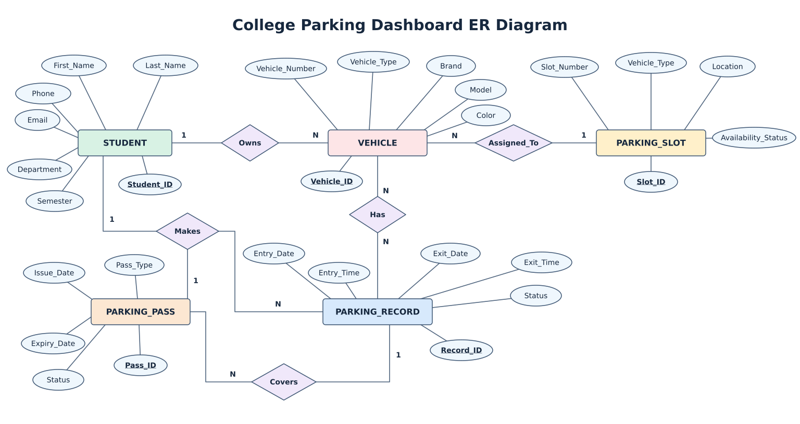

# CampusPark | College Parking Dashboard

CampusPark is a DBMS project for recording vehicle entry and exit, assigning parking slots, and managing student parking passes. Gate staff can check a vehicle number, see where space is available, and close the same parking record when the vehicle leaves. Administrators can review traffic patterns and parking duration from those records.

- [Problem statement and requirements](Problem-Statement.md)
- [ER diagram](docs/parking-er-diagram.svg)
- [Reporting SQL](docs/parking-reports.sql)

## What the dashboard does

| Page | What you can do |
|---|---|
| Overview | See total, occupied and available slots. Switch between traffic and occupancy charts for today, yesterday, the last seven days, or the last 14 full days. |
| Parking slots | Filter slots by location, vehicle type, and availability. Select a free slot to start a check-in. |
| Entry & exit log | Search by vehicle plate, student ID, name, or slot. Filter by entry date and status, review unusually long open visits, and see average completed parking duration. |
| Vehicles | Register a car or bike, associate it with a student, and look up the owner by vehicle number. |
| Parking passes | Issue semester or temporary passes and see which are valid, expiring soon, or expired. |

A successful entry or exit refreshes the page data immediately. An active dashboard also checks the shared register every ten seconds while it is idle. Staff record vehicle movements using the dashboard. Campus dates and reports use Asia/Kolkata.

## Campus capacity

The college provided combined totals of 50 cars and 100 bikes. The current configuration uses a 60/40 split between Main Gate and Academic Block until the exact counts per area are available.

| Location | Car slots | Bike slots | Total |
|---|---:|---:|---:|
| Main Gate | 30 (`A-01` to `A-30`) | 60 (`C-01` to `C-60`) | 90 |
| Academic Block | 20 (`B-01` to `B-20`) | 40 (`D-01` to `D-40`) | 60 |
| **Campus total** | **50** | **100** | **150** |

## ER diagram and database design



The diagram captures the original project design. The implementation stores each slot assignment on `parking_record` so that a vehicle can use different slots on different visits and the history retains the slot used. Each visit links to one vehicle. The student's identity is obtained through that vehicle, and a visit can reference the parking pass used at entry.

| Table | Responsibility |
|---|---|
| `student` | Student ID, name, department, semester and optional contact fields |
| `vehicle` | A registered plate, vehicle type, optional brand/model/color and its owning student |
| `parking_slot` | A named parking space with its location and supported vehicle type |
| `parking_pass` | The student, pass type, issue date and expiry date |
| `parking_record` | One visit with vehicle, slot, pass reference, entry time, and exit time |
| `configuration` | Tracks first-time initialization of the sample dataset |

### How check-in and check-out work

1. A staff member enters a vehicle number. The dashboard removes spaces and hyphens and converts it to uppercase before looking up the registration.
2. The server checks that the vehicle exists, the slot accepts its vehicle type, and the student has a valid pass.
3. The database records the check-in with a blank exit timestamp. Two unique indexes prevent a second open visit for the same vehicle and a second active assignment for the same slot.
4. At departure, the server updates the vehicle's open record with the exit timestamp. The dashboard now counts the slot as available while keeping the visit in the history.

Slot availability is calculated from open visits. The occupancy chart finds the highest number of vehicles parked at once in each chart interval. The activity chart counts arrivals and departures separately.

## Run locally

Install **Node.js 24 or later**. The project uses Node's built-in SQLite support and has no npm packages to install.

```bash
git clone https://github.com/devhnegi7-cell/college-parking-dashboard.git
cd college-parking-dashboard
npm run dev
```

Open [localhost:3000](http://localhost:3000/). The app creates a local database in `.local/parking.sqlite` and loads fictional students, vehicles, passes, and two weeks of sample visits on the first request. Those records are labeled as sample data in the dashboard.

### Try a complete parking visit

1. On **Overview**, choose **Record exit** and enter `HR 51 QZ 4816`.
2. Go to **Parking slots** and find `A-01`. It should now show **Available**.
3. Select the slot, enter `HR 51 QZ 4816`, and choose **Check in**. The slot becomes occupied and a new record appears in the log.
4. Under **Parking passes**, use the status filter to inspect the sample expired and expiring passes.

**Clear sample records** on the overview removes visits linked to sample vehicles and unused sample registrations. The slot inventory and non-sample vehicles and visits remain available.

## Source files and verification

| Path | Purpose |
|---|---|
| [web/](web/) | HTML, responsive layout, dashboard pages, forms and charts |
| [worker/index.js](worker/index.js) | API routes, registration and pass validation, check-in and check-out, initial sample records |
| [drizzle/0000_parking.sql](drizzle/0000_parking.sql) | SQLite schema, foreign keys and indexes |
| [drizzle/0001_parking_capacity.sql](drizzle/0001_parking_capacity.sql) | Adds the 150-slot inventory while preserving existing slot IDs |
| [scripts/local-db.mjs](scripts/local-db.mjs) | Local adapter that runs the same API against SQLite |
| [scripts/check.mjs](scripts/check.mjs) | Checks capacity by location and vehicle type, registration, pass validation, conflicting assignments, and exit |
| [docs/parking-reports.sql](docs/parking-reports.sql) | Queries for availability, open visits, peak arrival hours, duration and expiring passes |

```bash
npm test
npm run build
```

Locally the app uses SQLite. The hosted version uses a Cloudflare Worker with a D1 database. The hosted dashboard is private. The repository contains only source, the schema, and fictional sample definitions.
